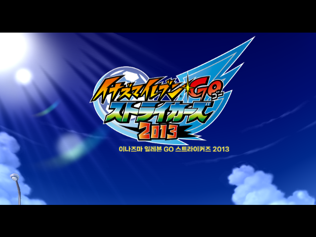
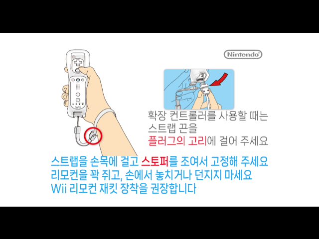
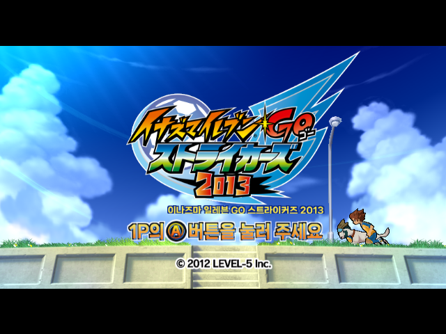
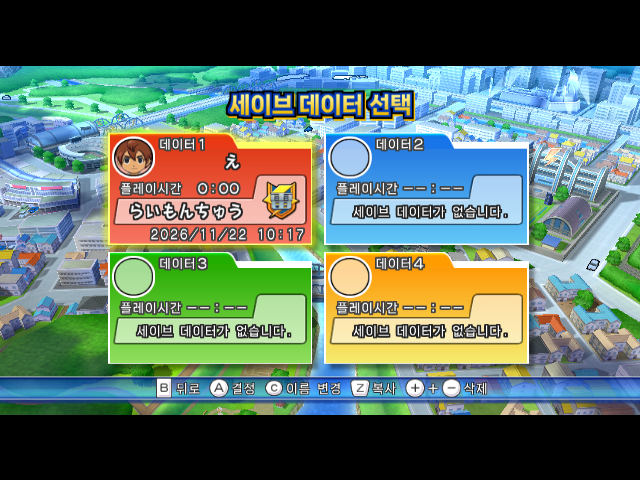
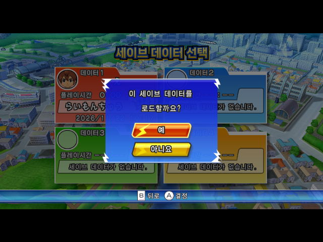
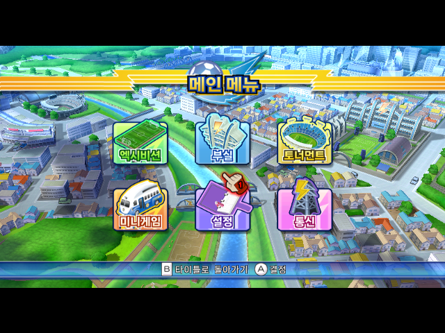
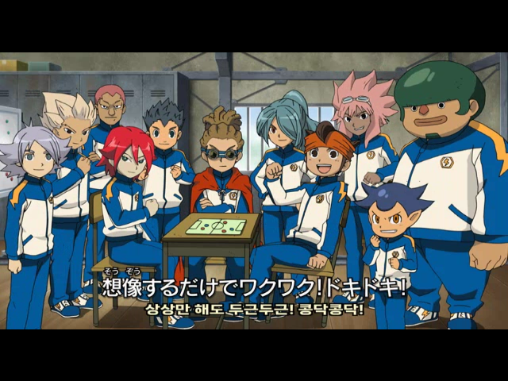
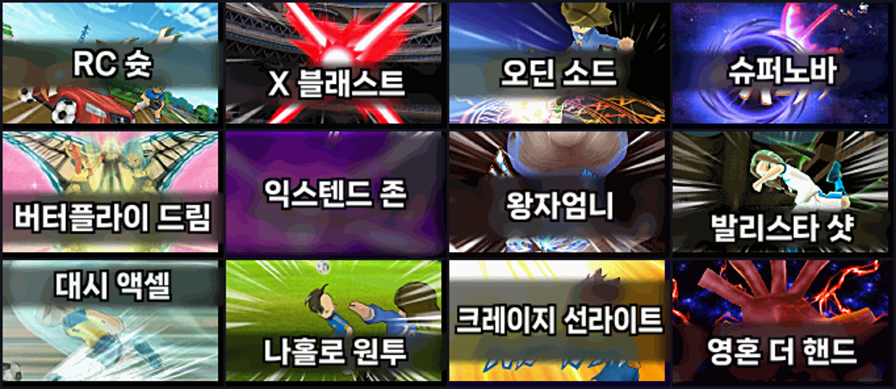
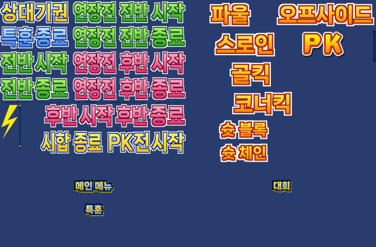
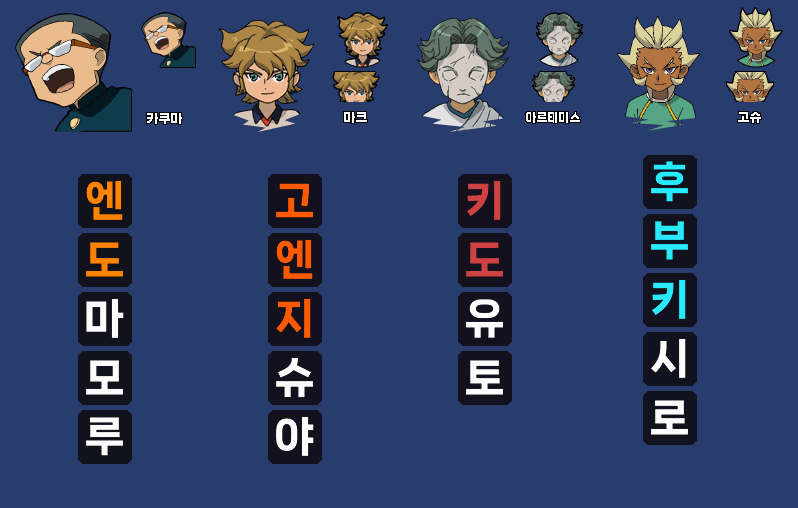

# 이나즈마 일레븐 GO 스트라이커즈 2013 Wii 한글패치

Wii 일본판 **이나즈마 일레븐 GO 스트라이커즈 2013(イナズマイレブンGO ストライカーズ 2013, S5SJHF)**용 비공식 한국어 패치입니다. 다음 항목을 한국어로 바꿨습니다.

- **게임 문자열:** 메뉴·시스템 메시지, 부실·대회·특훈·수행 대사, 캐릭터·필살기 설명, 튜토리얼, 아이템·유니폼·엠블럼, 선수·팀·필살기 이름, 스태프롤 등 약 7,200종 전체
- **실행 파일 문자열:** 통신 상태 표시, 기본 선수·팀 이름 등 14개
- **게임 글꼴:** 3종에 한글 2,351자 (원본 글꼴의 한자 칸 재사용)
- **그림 글자:** 약 1,250장
  - 메인 메뉴 아이콘·로고, 화면 제목 약 100종, 시합 배너(전반 시작·파울·코너킥 등)
  - 필살기 컷인 420장, 필살기 발동 자막 444종, 얼굴 이름표 387장, 세로 명판 57장
  - 스타디움·미니게임 제목, 결과·순위·토너먼트 표시, 스트랩 안내 화면 등
- **오프닝 동영상:** 일본어 가사는 그대로 두고 바로 아래에 한글 가사를 한 줄로 넣었습니다(4:3·16:9 모두).
- **타이틀 로고:** 원래 로고를 가리지 않도록 아래에 작게 「이나즈마 일레븐 GO 스트라이커즈 2013」을 넣었습니다.

현재 배포판은 **v1.0.1 (2026-11-25)**입니다.

[패치 다운로드](https://github.com/snake759494/inazuma-eleven-go-strikers-2013-wii-korean-patch/releases/latest) · [기술 설명](docs/TECHNICAL.md) · [재빌드](docs/BUILD.md) · [변경 기록](CHANGELOG.md) · [권리 안내](RIGHTS.md)



릴리즈에 첨부한 파일은 한글패치 **IE_GO_Strikers_2013_Wii_KO_v1.0.1.xdelta** 하나입니다.

저장소에는 제작 소스와 한국어 번역만 공개합니다. 다음 파일은 넣지 않았습니다.
- 원본 디스크 이미지와 패치를 적용한 디스크 이미지
- 게임에서 추출한 파일
- 일본어 원문
- 글꼴 파일과 외부 실행 파일

GitHub가 자동으로 만드는 Source code ZIP/TAR는 저장소 소스를 압축한 것이며, 게임 파일이 아닙니다.

## 게임 소개 및 대상 버전

『이나즈마 일레븐 GO 스트라이커즈 2013』은 레벨파이브가 2012년 12월 13일 일본에서 발매한 Wii용 축구 액션 게임입니다. 『이나즈마 일레븐』 1~3편과 『GO』, 『GO 크로노 스톤』의 캐릭터가 한자리에 모여, 필살기·화신·믹시맥스를 쓰며 시합을 벌입니다. 엑시비션·토너먼트·미니게임 모드와, 자기 팀을 키우는 부실(동아리방) 모드가 들어 있습니다.

이 패치는 **일본판 S5SJHF**에만 적용됩니다. 파일 이름보다 아래 표의 크기와 해시가 맞는지가 중요합니다.

## 적용할 원본

| 항목 | 값 |
| --- | --- |
| 게임 ID | S5SJHF |
| 원본 형식 | 수정되지 않은 일본판 Wii 디스크 ISO (4,699,979,776 바이트) |
| **원본 ISO MD5** | `536a55a6703e4789e3652a180f8c91fa` |
| 원본 ISO SHA-1 | `dd1dd08f89ba557b400abf18aea3d377b0362c4f` |
| 원본 ISO SHA-256 | `affd7475436bb31e5f49f2fe3e7a2cd3449467a2d48f50420c19c229781dfbee` |
| (참고) RVZ로 받은 경우 RVZ MD5 | `293cb5855d69b0355eb3ea95bfd972e2` |
| xdelta 파일 크기 | 934,549,365 바이트 |
| xdelta SHA-256 | `5fe419d9c61b725890a0ea377bd8afff576a3e0e1cc937cea0903143852c33e1` |
| 적용 결과 ISO 크기 | 4,699,979,776 바이트 |
| 적용 결과 ISO SHA-1 | `95d8ecead61368f40712a7ba752d3ab109edb58f` |
| 적용 결과 ISO SHA-256 | `d8a4a72244e8824cf0fa3f83b199480ed5abfbe8c0dc9117cdf6b028014e3d28` |

원본 게임 파일은 사용자가 직접 준비해야 합니다.

## 패치 적용 방법

### 1. RVZ·WBFS·WIA를 ISO로 바꾸기

xdelta는 **압축하지 않은 ISO**에만 적용됩니다. 원본이 RVZ 등 압축 형식이면 먼저 Dolphin에서 ISO로 바꿉니다.

1. Dolphin 게임 목록에서 게임을 우클릭하고 **파일 변환**을 고릅니다.
2. 형식을 **ISO**로 정하고 변환합니다. 이때 "쓰레기 데이터 제거"는 끄세요. 켜면 해시가 달라집니다.

명령줄에서는 다음과 같이 합니다.

```powershell
.\DolphinTool.exe convert -i '.\Inazuma Eleven Go - Strikers 2013 (Japan).rvz' -o '.\Inazuma Eleven Go - Strikers 2013 (Japan).iso' -f iso
```

### 2. 해시 확인

```powershell
Get-FileHash -Algorithm MD5 -LiteralPath '.\Inazuma Eleven Go - Strikers 2013 (Japan).iso'
```

위 표와 다르면 적용을 중단하세요.

### 3. xdelta UI로 적용

1. 릴리즈에서 `IE_GO_Strikers_2013_Wii_KO_v1.0.1.xdelta`를 받습니다.
2. xdelta3 패치를 지원하는 도구에서 **Apply Patch** 기능을 엽니다.
3. **Patch**에는 xdelta 파일을, **Source File**에는 해시가 일치하는 원본 `.iso`를 선택합니다.
4. **Output File**에는 새 파일 이름을 지정합니다(예: `Inazuma Eleven Go - Strikers 2013 (Korean).iso`).

xdelta는 호환성을 위해 압축·2차 압축·파일 경로 헤더 없이 만들었습니다. xdelta 자체는 [공식 프로젝트](https://github.com/jmacd/xdelta)를 참고하세요.

### 명령줄로 적용

```powershell
.\xdelta3.exe -d -s '.\Inazuma Eleven Go - Strikers 2013 (Japan).iso' '.\IE_GO_Strikers_2013_Wii_KO_v1.0.1.xdelta' '.\Inazuma Eleven Go - Strikers 2013 (Korean).iso'
```

결과 ISO는 Dolphin에서 그대로 실행하거나, 원하면 다시 RVZ로 변환해 보관해도 됩니다.

**세이브**
- 게임 ID는 원본과 같으므로 Wii 세이브 데이터는 원본판과 함께 쓸 수 있습니다. 다만 일본판에서 만든 세이브의 팀·선수 이름은 일본어 그대로 보입니다(새로 만들면 한글 기본 이름이 들어갑니다).
- 원본판에서 만든 세이브 스테이트는 쓰지 마세요.

## 스크린샷

| | |
| --- | --- |
|  |  |
|  |  |
|  |  |





## 한글화 범위

- **게임 문자열(`dat.bin`):** 메인 텍스트(메뉴·부실·대회·특훈·수행·감독/매니저 메모·캐릭터 설명·아이템 등), 필살기 설명·이름, 스타디움, 팀 데이터, 스태프롤, 튜토리얼 등 35개 파일
- **실행 파일(`main.dol`):** 통신 상태 표시, 「이름 없음」, 기본 선수·팀 이름 등 14개
- **글꼴:** 게임 글꼴 3종(보통·굵게·작은 글꼴)에 한글 2,351자
- **그림 글자:** 위 목록 참고
- **동영상:** 오프닝 2종 한글 가사(일본어 가사 아래 한 줄)
- **원문 유지:** 음성, 노래, 오프닝의 일본어 가사(한글 가사를 아래에 추가), 영문 표기, 팀 엠블럼 속 한자 로고, 저작권 표기, Wii HOME 메뉴, 본체 시스템 오류 메시지

## 알려진 한계

**표기**
- 그림 글자는 원래 칸 크기에 맞추느라 일부 글자 폭을 줄였습니다.
- 튜토리얼 화면 그림(스크린샷 속 말풍선·기술명), 랜덤/셔플/룰렛 찬스 배너는 원문을 그대로 두었습니다.
- 원본 배치를 유지하려고 일부 32비트 화면 그림은 바뀐 영역의 색 수를 줄였습니다.

**확인 범위**
- Dolphin에서 직접 확인한 화면은 다음과 같습니다.
  - 스트랩 안내, 오프닝 동영상(한글 가사), 타이틀, 세이브 데이터 선택·생성·이름 입력, 튜토리얼 대사, 메인 메뉴
- 메인 메뉴 안쪽의 각 모드·시합 화면은 Wii 리모컨 포인터 조작이 필요해 게임 화면에서 모두 보지는 못했고, 그림 파일로 확인했습니다.
- 실기 Wii에서의 동작은 확인하지 못했습니다. 결과 ISO는 가짜 서명이므로 실기에서는 USB 로더 등 서명 검사를 하지 않는 환경이 필요합니다.

문제가 있으면 이슈로 알려 주세요. 스크린샷을 함께 올려 주시면 빨리 고칠 수 있습니다.

## 재빌드

[docs/BUILD.md](docs/BUILD.md)를 참고하세요.
